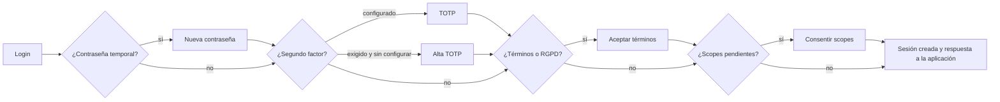

<!-- @autogenerated -->
# Inicio de sesión

Cuando una aplicación envía al usuario a `/authorize` y no hay sesión válida, el servidor muestra una secuencia de pantallas. Cada pantalla resuelve un reto; cuando no queda ninguno pendiente, se crea la sesión SSO y se devuelve la respuesta a la aplicación.

## Orden de comprobaciones

Antes de mostrar nada se valida la solicitud: cliente, `redirect_uri`, `response_type`, audiencias, PKCE, `prompt`, hints. Si algo falla, no se pide la contraseña (ver [Solicitud de autorización](04-autorizacion.md)).

Tras la contraseña, el servidor evalúa en este orden y muestra la primera pantalla pendiente:

1. **Contraseña** correcta.
2. **Contraseña temporal**: el usuario debe cambiarla.
3. **Segundo factor**: si el usuario lo tiene activado o la aplicación pide nivel MFA (`acr_values`). Si la aplicación lo pide y el usuario no lo tiene configurado, alta del TOTP. El campo `force-mfa` del tenant **no tiene efecto** hoy.
4. **Términos de uso y propósitos RGPD** pendientes.
5. **Consentimiento de scopes** para este cliente.

Tras resolver cualquier paso se vuelve a evaluar la lista completa, de modo que un mismo login puede pasar por varias pantallas.

## Pantallas

### Login

- Usuario y contraseña. `login_hint` (máx. 256 caracteres) rellena el usuario.
- La contraseña se cifra en el navegador con una clave temporal del servidor y el formulario se firma (protección CSRF). Hace falta JavaScript.
- Enlaces: recuperar contraseña, registrarse, recuperar el segundo factor y un botón por cada proveedor federado activo. Hoy no dependen de la configuración del tenant (ver más abajo).

### Bloqueo por intentos

Diseño: tras 3 intentos fallidos consecutivos la cuenta queda bloqueada 6 horas; un login correcto pone el contador a cero. Además hay un límite de peticiones por IP (`app.rate-limit.*`).

**Comportamiento actual (fallo conocido)**: el bloqueo se registra en el **cuarto** fallo (`UserLoginService`, `val > LIMIT`) y la comprobación de `ActiveUserFindService.checkEnabled` está invertida: el usuario puede entrar mientras el bloqueo está vigente y queda rechazado, sin plazo, cuando ha vencido. Solo lo libera la acción *unlock* de la administración.

### Nueva contraseña

Para usuarios con contraseña temporal (por ejemplo, creados por un administrador). Pide la actual y la nueva.

### Segundo factor (TOTP)

- **Verificación**: código de 6 dígitos de una app compatible con Google Authenticator.
- **Alta**: muestra un QR con la semilla y pide el primer código para confirmarla. La app del usuario muestra la cuenta como `{usuario} at ` con emisor `no`: no aparece el nombre del tenant ni de la aplicación (`display-name` no se usa).
- **Códigos de recuperación**: si el usuario perdió el dispositivo, puede entrar con uno de sus códigos de recuperación (cada uno vale una vez). Se generan desde el perfil.
- Las passkeys (WebAuthn) se gestionan desde el perfil y tienen sus ceremonias de registro y autenticación propias.

### Términos de uso y RGPD

Muestra los términos vigentes del tenant (o del servidor de recursos) que el usuario no ha aceptado, y los propósitos RGPD con su casilla; los obligatorios están marcados. La aceptación se guarda con fecha, IP y agente.

### Consentimiento de scopes

Muestra los scopes que el cliente pide y el usuario no ha concedido aún a ese cliente.

- Los scopes desmarcados no se conceden y se retiran del consentimiento guardado.
- **Deny** devuelve `access_denied` a la aplicación (con su `state`).
- Con `prompt=consent` se muestra siempre, con todos los scopes pedidos, aunque haya consentimiento previo o sesión viva.
- El usuario puede revocar consentimientos desde su perfil.

### Recuperar contraseña

1. El usuario escribe su usuario o email.
2. Recibe un correo con un enlace a `/oauth/openid/{tenant}/recover` con un código de un solo uso, válido 12 horas.
3. Fija la nueva contraseña y el login continúa con su cuenta.

Se ofrece siempre: `password-recovery-enabled` del tenant **no se consulta**.

### Registro

**No operativo.** El enlace aparece siempre, pero el adaptador de producción (`RegisterUserAdapter`) cancela toda solicitud: no se crea ninguna cuenta. `self-registration-enabled` y `auto-approve-registered-users` no se consultan. Las pruebas del flujo (`RegisterUserFlowTest`) usan un doble.

Diseño previsto: email y contraseña, correo con un código de verificación (`/oauth/openid/{tenant}/register`) y cuenta aprobada o pendiente según `auto-approve-registered-users`. Para dar de alta usuarios hoy, usar invitaciones o la administración.

### Enlace mágico

El usuario pide un enlace con su email y entra pulsándolo, sin contraseña; su caducidad es `magic-link-expiry-minutes`. No se ofrece ni se acepta cuando la aplicación pide nivel MFA.

**Desactivado en todos los tenants**: el adaptador de producción (`MagicLinkEnabledAdapter`) responde siempre «no», sea cual sea `magic-link-enabled`.

### Login federado

Proveedores disponibles: **Google** (OIDC con PKCE) y **SAML 2** (para SSO corporativo). Se configuran por tenant en `tenant-login-provider`.

1. El usuario pulsa el botón del proveedor. El servidor guarda un login pendiente ligado a ese navegador (cookie `DELEGATED_BINDING`, 10 minutos) y redirige al proveedor.
2. El proveedor vuelve a `/oauth/openid/-/delegated/authorization/{proveedor}`, que reenvía la respuesta al `/authorize` del tenant.
3. El servidor consume el login pendiente (un solo uso), comprueba que es el mismo navegador, tenant, cliente y proveedor, y valida la respuesta del proveedor.

**Elección de la cuenta local** (nunca por nombre visible):

1. Sin identificador estable del proveedor (`sub` de Google, `NameID` de SAML): rechazo.
2. Identidad ya enlazada a una cuenta del tenant: entra en ella.
3. Política del proveedor `manual`: solo valen enlaces existentes.
4. Email no verificado por el proveedor: rechazo.
5. Existe una cuenta local con ese email: con la política `verified-email` se enlaza, **sea cual sea la cuenta** (también una de administración o con contraseña); con `none`, solo si este proveedor ya la alcanza con otro identificador, o si la creó este mismo tipo de proveedor antes de que existieran los enlaces y es el único activo de ese tipo en el tenant.
6. No existe: se crea la cuenta con ese email, habilitada o no según `users-enabled-by-default` del proveedor, y se enlaza.

**Validación SAML**: firma de la respuesta o de la aserción usada, emisor = entity ID del IdP, audiencia = entity ID del SP, destino = URL del callback, ventana de validez (2 min de margen) e `InResponseTo` igual a la petición enviada. Las respuestas no solicitadas se rechazan. Un proveedor SAML sin `saml-idp-entity-id`, `saml-idp-sso-url` y `saml-idp-cert` no se ofrece.

No hay federación OIDC genérica ni Microsoft, Apple o GitHub (descartado; ver [Límites](09-limites-y-pendientes.md)).

## Idioma

`ui_locales` elige el primer idioma soportado (`oidc.ui-locales`, `en` por defecto); si no hay ninguno, se usa `Accept-Language`.

## Correos

El login, las invitaciones y la recuperación envían correos por la cola de notificaciones. Los campos `*-email-template` del tenant **no se consultan**.

**Aviso de login (fallo conocido)**: tras cada autenticación correcta (login, reutilización de la sesión, canje del code y cada refresh) se encola un correo urgente con la plantilla `user.login` (usuario y fecha). No va al usuario ni a un administrador configurable, sino a una dirección fija en el código (`NotifyLogin`). Un fallo al encolarlo no interrumpe el login.
