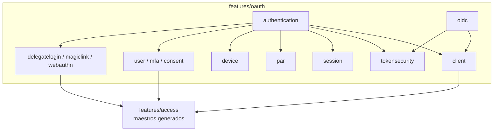

<!-- @autogenerated -->
# Arquitectura

El servidor OIDC vive en `features/oauth` del paquete base de la aplicación (`src/main/java/net/civeira/phylax/features/oauth` en la aplicación de referencia, unos 435 ficheros; en la plantilla, `{{base}}/features/oauth`). Cada subpaquete es un contexto con capas hexagonales `domain` / `application` / `infrastructure`, y documenta su responsabilidad en su `package-info.java`.

## Subpaquetes

| Paquete | Responsabilidad | Clases principales |
|---|---|---|
| `authentication` | Orquesta `/authorize`, `/token`, UserInfo y logout; pasos del login; grants | `AuthorizeHtml`, `OidcStepRouter`, `step/*Step`, `AuthenticateUser`, `IssueTokenUsecase`, `AuthorizationCodeGrant`, `RefreshTokenGrant`, `TokenExchangeGrant`, `TokenIssuer`, `granter/*Granter`, `TokenController`, `InformationController` |
| `client` | Resolución y política de clientes, autenticación del cliente, DCR, API keys | `ClientDetails`, `ClientAuthenticator`, `ClientCredentials`, `ClientAuthMethod`, `ClientAuthPolicy`, `RedirectUriPolicy`, `OauthClientPolicy`, `DcrMetadataPolicy`, `JwtAlgorithms`, `ClientRetrieveAdapter`, `ClientRegisterController` |
| `tokensecurity` | Firma y verificación de JWT, claims por tipo de token, JWKS, introspección, revocación, DPoP, pairwise, ACR | `JoseTokenSigner`, `JwtTokenBuilder`, `ClaimsMapper`, `TokenVerifier`, `AccessTokenPolicy`, `AcrPolicy`, `SubjectResolver`, `RefreshFamily`, `DpopProofVerifier`, `SigningKeyRotationJob` |
| `session` | Sesiones SSO, codes de autorización, claves temporales de formulario, iframe de sesión, limpieza | `SessionStoreSqlAdapter`, `TemporalKeysSqlAdapter`, `SessionStateService`, `PublicSessionId`, `OAuthCleanupScheduler`, `SessionManagementController`, `UserSessionController` |
| `oidc` | Documento de discovery compuesto por *contributors* | `OpenIdConfigurationController`, `*Contributor` |
| `par` | Pushed Authorization Requests y request objects | `PushAuthorizationUsecase`, `ResolveParRequestUsecase`, `ParBindingDigestAdapter` |
| `device` | Device flow (RFC 8628) | `DeviceAuthorizationService`, `DeviceVerificationHtml` |
| `user` | Validación de credenciales, recuperación, registro, códigos de verificación | `UserLoginService`, `ActiveUserFindService`, `VerificationCodeService`, `ChangePasswordAdapter`, `RegisterUserAdapter` |
| `mfa` | TOTP y códigos de recuperación | `OtpMfaService`, `MfaRecoveryService` |
| `consent` | Términos de uso, propósitos RGPD y consentimiento de scopes | `RequiredConsentService`, `ScopesConsentAdapter`, `TermsOfUseConsentUsecase`, `GdprConsentUsecase` |
| `delegatelogin` | Login federado (Google, SAML) | `DelegateLogin`, `PendingDelegation`, `GoogleDelegatedAccessProvider`, `SamlDelegatedAccessProvider`, `SamlResponseValidator`, `DelegatedAccessAuthValidatorAdapter` |
| `magiclink` | Enlace mágico | `MagicLinkRequestController`, `MagicLinkVerifyHtml` |
| `webauthn` | Passkeys | `WebAuthnController`, `WebAuthnCredentialAdapter` |
| `profile` | Páginas `/me` y API del perfil | `ProfileHtmlController`, `ProfileMeController` |
| `userinvitation` | Invitaciones | `InvitationController`, `InvitationAdminPolicy` |
| `gdpr` | Exportación y borrado de cuenta | — |
| `theme` | Decoración HTML por tenant | — |

## Dependencias

- `features/oauth` define los puertos (`*Gateway`) en sus `domain/gateway` y los implementa en `infrastructure/driven`.
- Los adaptadores de clientes, usuarios, consentimientos, proveedores federados, etc. leen y escriben las entidades de `features/access` (código generado: `oauth-client`, `resource-server`, `tenant-config`, `user`…) a través de sus repositorios.
- El estado propio del protocolo (sesiones, codes, claves, revocaciones, PAR, device, anti-replay) vive en tablas `_oauth_*` con adaptadores SQL escritos a mano. Ver [Persistencia](06-persistencia.md).

## Generación y plantillas

Gran parte de `features/oauth` se genera con las plantillas Quarkus de `civi-generator` a partir del modelo `multitenant-oidc.xml`, y `features/access` sale íntegramente del modelo.

- Un cambio de esquema se hace en el modelo y se regenera; no se editan a mano las clases generadas de `access` ni las migraciones.
- Los cambios hechos a mano en `features/oauth` deben llevarse a la plantilla con `.make/binary/sync-oidc-template.py --apply` (y `--include-new` para clases nuevas) antes de regenerar, o se pierden. `--check` comprueba que no haya diferencias.
- El mismo modelo alimenta la plantilla PHP (lughauth-api); los renombrados del modelo hay que trasladarlos también allí.

## Principios de diseño

- **Una sola fuente por regla**: algoritmos (`JwtAlgorithms`), métodos de autenticación (`ClientAuthMethod`), claims soportadas (`AuthorizationRequestPolicy.SUPPORTED_CLAIMS`) y modos de respuesta son constantes que usan a la vez la lógica, el discovery y la validación de DCR.
- **Validar antes de gastar**: codes, refresh, PAR, initial access tokens y device codes se consumen con una operación atómica condicional y solo después de comprobar todo lo demás; una petición rechazada no gasta la credencial.
- **Fallo cerrado**: sin sal pairwise, sin tabla anti-replay, sin clave de cifrado del cliente o con un algoritmo no soportado, el servidor rechaza en lugar de degradar.
- **Errores OAuth tipados**: `OAuthTokenException` lleva `error`, descripción y estado HTTP; los controladores solo la serializan.
